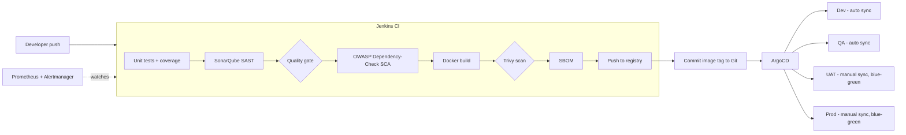

# Secure Microservices Delivery on Kubernetes

[](https://github.com/jvinayk5/secure-k8s-delivery/actions/workflows/ci.yml)

A reference implementation of an enterprise **DevSecOps delivery platform**: containerised Node.js and Spring Boot microservices, a security-gated Jenkins CI pipeline, and GitOps-driven promotion across **Dev → QA → UAT → Production** on Kubernetes with ArgoCD.

> A hands-on reference implementation of a DevSecOps delivery platform, built as a learning and portfolio project. It uses sample services only; no company code, configuration or credentials.

## Goals

| Area | Approach |
|---|---|
| Consistent builds | Shared platform base images; app images build on top of them |
| Smaller, safer images | Multi-stage builds, non-root runtime, JRE-only Java image |
| Shift-left security | SAST, SCA, image scanning and SBOM gate every build |
| Reliable releases | Environment-aware CD with rolling and blue-green strategies |
| Auditable deployments | Git is the source of truth; ArgoCD reconciles the cluster |
| Pipeline reliability | Alerting on build-agent CPU, memory and disk |

## Architecture



Jenkins never deploys. It only builds, verifies and commits a new image tag; ArgoCD reconciles the cluster to what Git says. That gives every deployment an audit trail and makes rollback a `git revert`.

## What is demonstrated

**Standardised containers** (`images/`, `apps/*/Dockerfile`)
- Reusable platform base images for Node.js and Java: pinned versions, non-root user, `tini` as PID 1, JRE-only runtime.
- Multi-stage application images that build on the platform base, so patching a base image fixes every service on rebuild.

**Security-gated CI** (`ci/Jenkinsfile`, `.github/workflows/ci.yml`)
- Unit tests with coverage, SonarQube SAST with a blocking quality gate, OWASP Dependency-Check SCA.
- Trivy image scan that fails on fixable HIGH/CRITICAL findings, plus a CycloneDX SBOM archived per build.
- One parameterised pipeline for both stacks, with branch-aware environment mapping (`develop` → dev, `release/*` → qa, `main` → uat, prod only by explicit parameter).
- A GitHub Actions workflow runs the equivalent checks on this repo so the badge reflects real results.

**Environment-aware CD and GitOps** (`charts/`, `gitops/`, `ci/promote.sh`)
- One Helm chart, four values files. Dev and QA use rolling updates; UAT and Prod use Argo Rollouts blue-green with a preview service.
- ArgoCD `ApplicationSet` generates one app per environment: dev and QA auto-sync, UAT and Prod require a manual sync as the approval gate.
- Hardened pods: non-root, read-only root filesystem, dropped capabilities, seccomp, NetworkPolicy, PodDisruptionBudget, HPA.

**CI/CD observability** (`monitoring/`)
- Prometheus rules alerting at 80% CPU, memory and disk on Jenkins build agents, used to trigger scale-out and scale-in.

## Repository layout

```
images/        platform base images (node, java)
apps/          sample node-service and spring-service
ci/            Jenkinsfile, Sonar config, Trivy ignore file, GitOps promote script
charts/        reusable Helm chart + per-environment values
gitops/        ArgoCD AppProject and ApplicationSet
monitoring/    PrometheusRule for build-agent capacity
.github/       GitHub Actions workflow
```

## Try it locally

```bash
# Node service tests
cd apps/node-service && npm test

# Build the platform base, then the app image
docker build -t node-base:local images/node-base
docker build -t node-service:local --build-arg BASE_IMAGE=node-base:local apps/node-service

# Scan it
trivy image --severity HIGH,CRITICAL --ignore-unfixed node-service:local

# Render the chart for production
helm template demo charts/microservice -f charts/microservice/values-prod.yaml
```

Using this on your own cluster needs a Jenkins with SonarQube and Dependency-Check configured, a container registry (set `REGISTRY_HOST`), and ArgoCD plus Argo Rollouts installed.

## Tech stack

Jenkins · Docker · Trivy · SonarQube · OWASP Dependency-Check · Kubernetes · Helm · ArgoCD · Argo Rollouts · Prometheus · Alertmanager · Node.js · Spring Boot

## Author

Vinay Kumar J — [GitHub](https://github.com/jvinayk5)

## License

MIT
